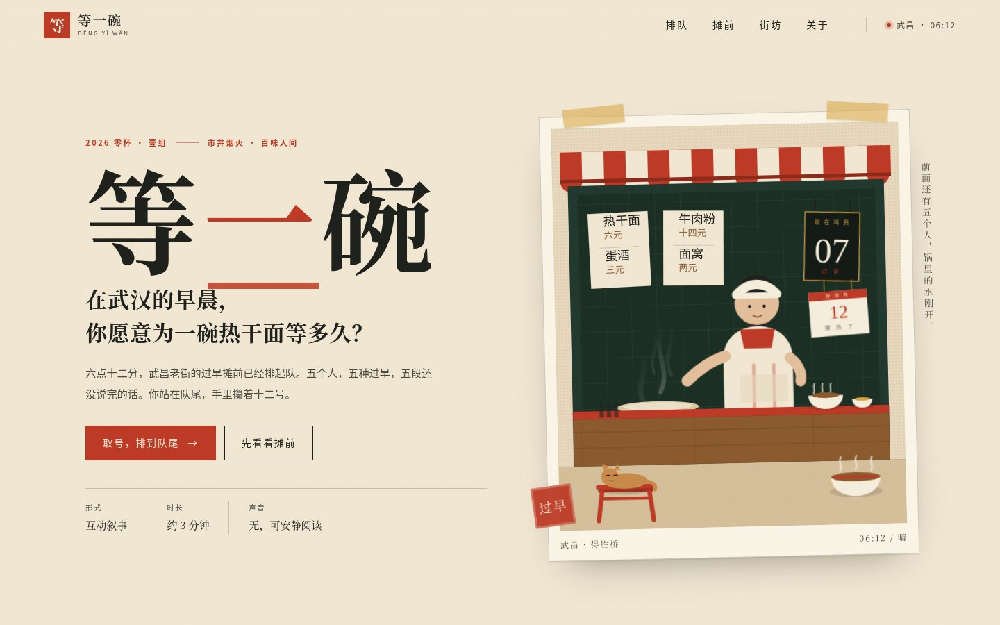
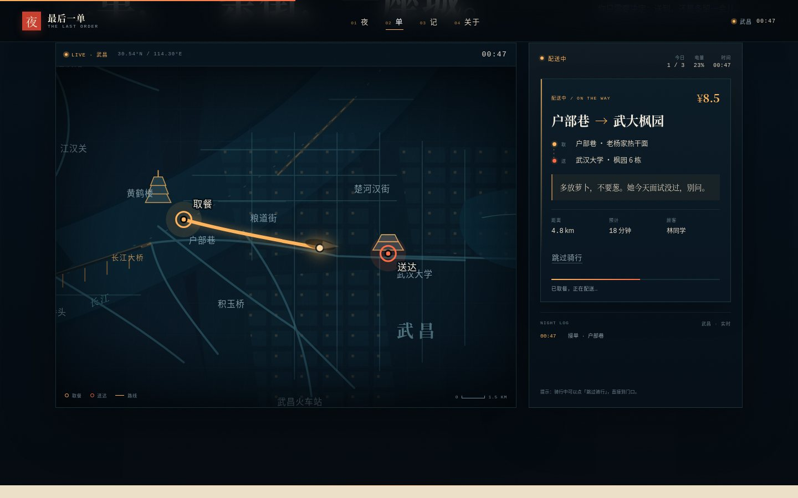
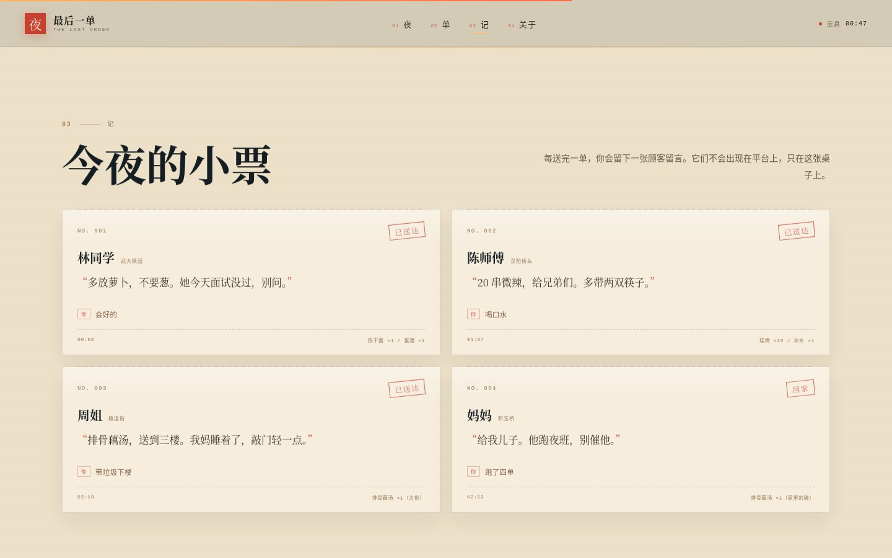

# 最后一单

> 2026 年武汉大学「零杯」网页设计大赛 参赛作品 · **壹组**
> 主题：**市井烟火 · 百味人间** ｜ 形态：单页互动叙事 / 轻游戏

**凌晨两点，武汉还没睡。你还有三单要送。跑完这三单，就回家。**

00:47，户部巷的雨刚停。你是一名外卖骑手，手机还剩 23% 的电。前面是三单：武大枫园的热干面、汉阳桥头的烧烤、粮道街的一份藕汤。每个顾客都留了一句话。你穿过武昌的夜，把餐送到；最后一单，送到自己家。

## 作品速览

| 首屏：最后一单 | 送单：地图与订单 | 小票：今夜的四句话 |
|---|---|---|
|  |  |  |

<sub>1440×900 实机截图。地图为示意，不用于导航；图中为已完成一夜后的小票。</sub>

## 一、队伍信息

| 项 | 内容 |
|---|---|
| 队伍名 | `待填` |
| 组别 | 壹组 |
| 队长 | `待填（姓名 / 学号 / 学院 / 联系方式）` |
| 队员 | `待填` |

> **匿名版说明**：提交匿名版时，本节及全文中的姓名、学号、学院、联系方式必须删除（由 `scripts/pack.sh` 自动处理）。

## 二、主题与设计思路

### 从选题开始重做

上一版《等一碗》把镜头放在清晨过早摊的排队上。这一版从选题开始重做：保留差异化最高、参赛作品最少的「市井烟火」主题（51 件参赛作品中仅 6 件），但把时间从清晨推到凌晨，把「被服务的人」换成「送餐的人」——外卖骑手。

选择骑手，是因为他天然站在城市的缝隙里：他认识每一条近路，见过每一扇还亮着的窗，也知道一碗汤在夜里有多重。作品不拍樱花、不拍长江明信片，只拍凌晨两点还在营业的店、还在等餐的人、还在路上的车。**「市井烟火」不是怀旧滤镜，是此刻还亮着的灯。**

### 一句话与记忆点

- **一句话**：凌晨两点，送完三单外卖，最后一单送到自己家。
- **十秒记忆点**：地图上的订单一个个亮起来，骑手穿过武昌；收工时，四张顾客留言变成一张小票。
- **核心命题**：平台会在第二天清空顾客留言；我们把这一晚的几句话留下来，做成可以带走的纸。

### 视觉

| 元素 | 规格 | 用途 |
|---|---|---|
| 夜色 | `#04090e` / `#081520` / `#0b1b27` | 页面底、地图、面板 |
| 灯 | `#ffb45c` / `#ff6b45` | 路灯、路线、按钮、强调 |
| 朱红 | `#c8402f` | 印章、招牌、警示 |
| 纸 | `#ece0c9` / `#f7efdf` | 小票、留言、收工回执 |
| 青 | `#7fd1c8` | 江面、地图网格、辅助信息 |

- **字体**：宋体标题（Noto Serif CJK SC / Songti SC），黑体正文，等宽字只做时间码、地图标注与编号；不引入外链字体。
- **地图**：一张可缩放的夜间示意地图；道路、江面、桥、地标全部为 SVG；路线是唯一的高饱和琥珀色。每单送达后轨迹压暗留存、送达点编号亮起，地图于是有了「跑过」的痕迹；刷新后上一夜的 6 段路与 01–04 送达点仍在。
- **纸**：只有「小票」是纸——顾客留言、收工小票、按钮回执都落在纸色上，和夜里的屏幕形成对照。
- **动效**：地图运镜、路线绘制、电动车沿路径移动、场景淡入、小票落下；`prefers-reduced-motion` 下全部关闭。
- **顶栏**：不是静态标签。时间从 00:47 走到 02:52、电量从 23% 掉到 9%、四格送单进度随送达点亮，当前单留一格半亮的琥珀；进入纸色小票区时整组转成朱红。
- **不用的东西**：不做跑马灯、不做满屏渐变、不用图库照片、不用预设样式库。

### 结构

```
首屏（标题 / 夜街 / 入口）
 └ 送单（夜间地图 + 订单面板 + 骑行 + 场景层）
    ├ 00:47 户部巷 → 武大枫园
    ├ 01:18 粮道街 → 汉阳桥头
    ├ 02:03 归元寺 → 粮道街
    └ 02:41 粮道街 → 积玉桥（回家）
 └ 今夜小票（四张留言 + 夜班日志）
 └ 关于（选题 / 方法 / 素材 / 规格）
```

单页 + 两个浮层（场景、收工小票），没有二级页面；所有锚点有编号与滚动高亮。

### 交互

- **接单**：每单显示取餐点、送达点、距离、配送费与顾客留言；点「接单 · 出发」后，地图自动缩放到这一单的路线，顶栏时间与电量同步推进。
- **骑行**：路线按长度绘制，电动车沿路径移动；经过取餐点会停一下、弹出「取餐完成」，再继续送到门口。可以点「跳过骑行」。走过的路不会消失：每送达一单，轨迹压暗留在图上，送达点按 01–04 编号亮起；跑完一夜，地图就是这一夜的路网。刷新页面后，上一夜的路网仍留在地图上；点「再跑一夜」才清空。
- **门口**：四段场景，每段两个选择。选择改变收尾的一句话，并把「你 · 会好的」这样一行留在小票上；不改变订单结果。每单留下一张顾客留言小票。四段插画各有可读的细部：雨里共伞的两个人、桥下烧烤袋的热气、只开一条缝的门与门口的垃圾袋、妈妈手里的汤勺和早摆好的第二副碗筷。最后一单门口的选择还会改写纸票的落款。
- **收工**：四单之后自动生成一张「今夜收工」纸票，统计 4 单 / 19.5 公里 / 36.5 元，列出四张留言与四次选择；落款由最后一次选择决定——「最后一单，是妈下的。」或「最后一单，是回家。」纸票上压着一枚暗色路网存根：六段路与 01–04 四个点，和地图共用同一份路径数据；可以「存下这张小票」为 PNG（选择、落款与路网一起画进去）。
- **后来**：每张送达小票上「你 · 会好的」是一颗按钮，点开接上当时那句话之后发生的事（「她愣了一下，点点头……」）。四张票一次只开一张，收工后与刷新后的存档里都能重读；这是这场夜班唯一能回头看的抽屉。
- **记住**：完成的一夜写入 `localStorage`（键：`lastorder.v1`），记录夜数、四张留言、每单的选择与这一夜的结局；刷新后「今夜的小票」仍带着你当时留下的那一行，地图也停在 02:52 的收工路网。
- **再跑一夜**：回到第一单，清空地图上的旧路网；小票重新盖上「未送达」，上一夜仍留在浏览器里。
- **分享一夜**：收工纸票的页眉有一枚「分享 ↗」，可复制这一夜的链接。链接只带「第几夜 + 四个门口选择」，形如 `?night=1&c=0101`。朋友打开即还原同一张小票、同一条路网与 SHARED 标记；这是只读视图，不会覆盖对方浏览器里的存档。

### 内容

四位「收件人」：武大枫园的林同学、汉阳桥头的陈师傅、粮道街的周姐，以及最后一单的妈妈。四段对话、四张留言、每段两个选择，全部为本队原创虚构；地名取自武汉真实街区，地图为示意。

## 三、本地运行

纯静态站点，无构建步骤、无依赖安装：

```bash
python3 -m http.server 8080
# 打开 http://localhost:8080
```

也可以直接双击 `index.html`（`file://` 下 `localStorage` 可能被浏览器限制，记录功能自动降级）。推荐 Chrome 129；已在 1920 / 1440 / 720 / 390 宽度下检查，并单独覆盖 1440×720 矮横屏首屏。

### 自测

仓库带一个零依赖的浏览器回归脚本（Node 22+ 内置 WebSocket 驱动 Chromium，不需要安装 Playwright）：

```bash
python3 -m http.server 8080 &
node scripts/regression.mjs
```

脚本会检查 1920 / 1440 / 720 / 390 四档的横向溢出，在 1440 与 390 各跑完一整夜（接单 → 跳过骑行 → 场景 → 二选一 → 小票 → 回家加单 → 收工小票 → 再跑一夜），断言地图面板、场景层、小票上的选择、轨迹累积与 01–04 送达点、收工纸票上的 6 段路网存根与三颗按钮在首屏内、顶栏时间 / 电量 / 四格进度、刷新后的存档路网与收工态、分享链接还原且不改本地存档、localStorage 与控制台；另跑 1440×720 矮横屏首屏断言，并复核锚点落到纸面时顶栏切换纸色。截图输出到 `/tmp/lastorder-shots`。若 Chrome 不在常见路径，用 `CHROME=/path/to/chrome node scripts/regression.mjs` 指定；只跑移动端可加 `ONLY=mobile`，只跑桌面完整一夜可加 `ONLY=desktop`。

### 体积预算

站点只有 4 个文本文件，合计约 180KB（gzip 后约 46KB），首屏 0 张图片、0 个外部字体、0 个第三方脚本：

| 资源 | 原始 | gzip |
|---|---|---|
| `index.html` | 65.7KB | 16.5KB |
| `assets/css/main.css` | 53.5KB | 11.8KB |
| `assets/js/app.js` | 52.5KB | 14.4KB |
| `assets/js/data.js` | 8.3KB | 3.1KB |

`docs/screenshots/` 只用于文档展示，不参与页面加载。慢网/离线时打开也只请求这 4 个文件。

## 四、玩法

1. 从首屏「接单，出发」进入送单区。
2. 看完订单信息后点「接单 · 出发」；地图会缩放到当前路线，电动车开始移动。点「跳过骑行」可以直接到门口。
3. 到门口后读对话，二选一；选择会改变收尾的一句话，并作为「你」的一行留在小票上。每单留下一张小票。
4. 三单送完，会出现一张「回家」的加单；送完第四单，自动打开「今夜收工」小票。
5. 「存下这张小票」导出 PNG；「再跑一夜」重新开始；刷新页面后，完成的夜会留在「今夜的小票」里。

键盘：所有操作都是原生按钮；场景层内焦点被限制在当前对话框；Esc 可关闭收工小票。

## 五、第三方库清单

| 库 | 版本 | 用途 | 引入方式 |
|---|---|---|---|
| 无 | — | 全部为原生 HTML / CSS / JavaScript | — |

未使用 Bootstrap、Vue、Tailwind 等预设样式或框架；未引入外部字体、图片、图标库。场景、地图、小票、图标全部为内联 SVG 或 CSS 绘制。

## 六、素材来源

| 素材 | 来源 / 生成方式 | 授权 |
|---|---|---|
| 夜街首屏 / 地图 / 四个场景 | 本队手写内联 SVG | 原创 |
| 四单文案 / 顾客留言 / 对话 | 本队原创虚构 | 原创 |
| 小票、印章、纸张纹理 | CSS + SVG 绘制 | 原创 |
| 字体 | 系统字体栈（宋体 / 黑体 / 等宽），不外链 | 系统 |
| 表情 / 照片 / 图标库 | 未使用 | — |

地图上的街区、道路、桥梁与地名取自武汉真实地理，但经过压缩和重排，只用于叙事，不用于导航；人物与店铺均为虚构，无现实原型。

## 七、目录结构

```
.
├── index.html              # 唯一入口：首屏、送单、小票、关于
├── assets/
│   ├── css/main.css        # 夜间视觉系统、地图、场景、纸票、响应式
│   └── js/
│       ├── data.js         # 四单、场景、留言、收工文案
│       └── app.js          # 状态机、地图运镜、骑行、存档、Canvas 小票
├── docs/
│   ├── design.md           # 设计文档
│   └── screenshots/        # 文档截图（不参与页面加载）
├── scripts/
│   ├── pack.sh             # 完整版 / 匿名版打包
│   └── regression.mjs      # 无依赖浏览器回归
├── README.md
├── MISSION.md              # 任务书
├── STATE.md                # 状态与决策
├── BACKLOG.md              # 待办
└── progress/               # 每日记录
```

## 八、部署

GitHub Pages：`main` 分支根目录，push 即发布。站点无构建产物，任意静态托管均可。线上地址：<https://yourskenny.top/lingbei-showcase/>

## 九、打包与提交

```bash
./scripts/pack.sh <队伍名> <队长姓名>   # 例：./scripts/pack.sh 壹组 张三
```

脚本在 `dist/` 生成两个 zip，均可解压后直接打开 `index.html`：

| 压缩包 | 内容 | 用途 |
|---|---|---|
| `2026-零杯壹组-<队伍名>-<队长>-完整版本.zip` | 站点源码、README、设计文档、截图、自测脚本、STATE / BACKLOG / progress | 队内存档、组委会技术审查 |
| `2026-零杯壹组-<队伍名>-<队长>-匿名版本.zip` | 站点源码、匿名化 README、设计文档、截图、脚本 | 匿名评审提交 |

匿名版会删去 README 的队伍信息一节，并剔除 `MISSION.md`、`STATE.md`、`BACKLOG.md` 与 `progress/`；已用占位队伍实跑校验，匿名包中不再出现占位符或任何个人字段。

## 十、文档

- 设计文档：[`docs/design.md`](docs/design.md)
- 状态与决策：[`STATE.md`](STATE.md)
- 自测脚本：[`scripts/regression.mjs`](scripts/regression.mjs)
