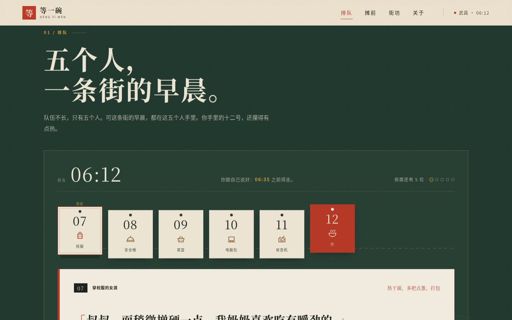
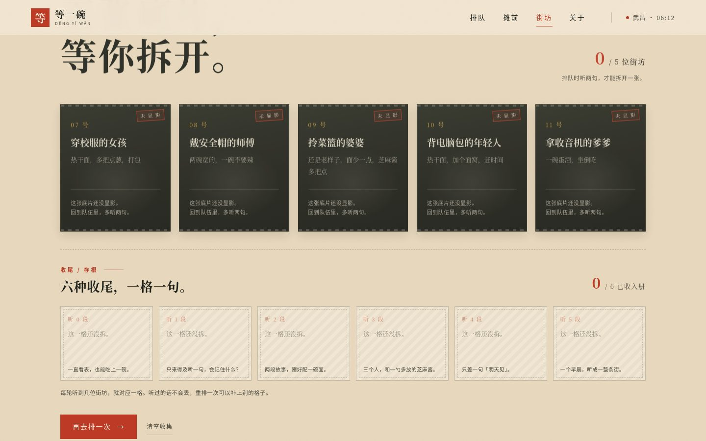

# 等一碗

> 2026 年武汉大学「零杯」网页设计大赛 参赛作品 · **壹组**
> 主题：**市井烟火 · 百味人间** ｜ 形态：单页互动叙事 / 轻游戏

**在武汉过早摊前，用五分钟排队，换五个人的早晨。**
六点十二分，你攥着十二号站在队尾。前面五个人，五种过早，五段还没说完的话。往前挪，还是多听两句？六点三十五，你跟自己说好要走。

## 作品速览

| 首屏：等一碗 | 排队：听两句，还是看表 | 街坊：五张底片等你拆开 |
|---|---|---|
|  |  |  |

<sub>1440×900 实机截图。街坊一张都没显影时，五张卡是带着齿孔的暗底片；听过谁，谁才在纸上显影。</sub>

## 一、队伍信息

| 项 | 内容 |
|---|---|
| 队伍名 | `待填` |
| 组别 | 壹组 |
| 队长 | `待填（姓名 / 学号 / 学院 / 联系方式）` |
| 队员 | `待填` |

> **匿名版说明**：提交匿名版时，本节及全文中的姓名、学号、学院、联系方式必须删除（由 `scripts/pack.sh` 自动处理）。

## 二、主题与设计思路

选「市井烟火」，是因为它离我们最近：不是被观看的地方志，而是人和人之间刚好够说两句话的距离。作品把镜头放在武昌一条虚构老街的过早摊前，用「排队」这件小事组织叙事——**等待不是空白，是可以拿来换故事的资源**。

- 视觉：纸色 `#F2E7D3`、墨色 `#1F211C`、朱红 `#BE3A26`、搪瓷绿 `#22392F`；宋体标题、黑体正文、印刷颗粒。
- 结构：首屏 → 排队 → 摊前 → 街坊 → 关于，单页锚点导航，无二级页面。
- 交互：听两句 / 看表二选一，累计时间走向 06:35；按本轮听过的 0–5 段给六种收尾；点单生成过早签；听过的人像在街坊区显影。
- 收集：街坊底片与六格「收尾存根」都写入 `localStorage`，重排可补齐不同收尾；每格记下时间、过早与日期。
- 内容：五个人物、五碗过早、六种收尾，全部为本队原创虚构文案。

详细版见 [`docs/design.md`](docs/design.md)。

## 三、本地运行

纯静态站点，无构建步骤、无依赖安装：

```bash
python3 -m http.server 8080
# 打开 http://localhost:8080
```

也可以直接双击 `index.html`（`file://` 下 localStorage 可能被浏览器限制，功能自动降级）。推荐 Chrome 129；已在 1920 / 1440 / 720 / 390 宽度下适配。

### 自测

仓库带一个零依赖的浏览器回归脚本（Node 22+ 内置 WebSocket 驱动 Chromium，不需要安装 Playwright）：

```bash
python3 -m http.server 8080 &
node scripts/regression.mjs
```

脚本会检查四档宽度的横向溢出、控制台报错，自动跑完一轮「排队 → 点单 → 过早签 → 再排一次」，并走查 390px 下的键盘 Tab 顺序；截图输出到 `/tmp/dengyi-shots`。若 Chrome 不在常见路径，用 `CHROME=/path/to/chrome node scripts/regression.mjs` 指定。

### 体积预算

站点只有 4 个文本文件，合计约 96KB（gzip 后约 27KB），首屏 0 张图片、0 个外部字体、0 个第三方脚本：

| 资源 | 原始 | gzip |
|---|---|---|
| `index.html` | 23KB | 6.8KB |
| `assets/css/main.css` | 40KB | 8.9KB |
| `assets/js/app.js` | 27KB | 7.9KB |
| `assets/js/data.js` | 7.5KB | 3.4KB |

`docs/screenshots/` 只用于文档展示，不参与页面加载。慢网/离线时打开也只请求这 4 个文件。

## 四、玩法

1. 从首屏「取号，排到队尾」进入排队。
2. 面对每个人选择「听两句」（+3 分钟，解锁一段故事）或「看表，先走」（+2 分钟）。
3. 轮到你时点一碗过早，生成专属「过早签」。
4. 用「存下这张签」把签存成 PNG，或「复制分享文案」发给一起过早的人；去「街坊」看已经显影的五张底片和六格收尾存根。
5. 进度存在 `localStorage`（键：`dengyiawan.v1`），可随时清空；每次成功点单会累计「第 N 次来」，盖在过早签上。

## 五、第三方库清单

| 库 | 版本 | 用途 | 引入方式 |
|---|---|---|---|
| 无 | — | 全部为原生 HTML / CSS / JavaScript | — |

未使用 Bootstrap、Vue、Tailwind 等预设样式或框架；未引入外部字体、图片、图标库。SVG 图标与场景均为自绘。

## 六、素材来源

| 素材 | 来源 / 生成方式 | 授权 |
|---|---|---|
| 过早摊场景 SVG | 本队自绘（`index.html` 内联 `<svg>`） | 原创 |
| 五个人物 / 菜单 / 结局文案 | 本队原创虚构 | 原创 |
| 图标（包、安全帽、菜篮、电脑、收音机、碗） | 本队自绘 SVG symbol | 原创 |
| 纸张颗粒纹理 | 纯 CSS 生成，无图片 | 原创 |
| 字体 | 系统字体栈（宋体 / 苹方 / 微软雅黑），不外链 | 系统 |

## 七、目录结构

```
.
├── index.html            # 唯一入口：首屏、排队、摊前、街坊、关于
├── assets/
│   ├── css/main.css      # 视觉系统与响应式
│   └── js/
│       ├── data.js       # 人物、菜单、结局文案
│       └── app.js        # 排队循环、存档、Canvas 过早签
├── docs/design.md        # 设计文档
├── scripts/pack.sh       # 完整版 / 匿名版打包
├── scripts/regression.mjs # 无依赖回归：四尺寸溢出、核心循环、键盘 Tab
├── MISSION.md            # 任务书
├── STATE.md              # 决策与进度
├── BACKLOG.md            # 待办
└── progress/             # 每日记录
```

## 八、部署

GitHub Pages：`main` 分支根目录，push 即发布。站点无构建产物，任意静态托管均可。

## 九、文档

- 设计文档：[`docs/design.md`](docs/design.md)
- 状态与决策：[`STATE.md`](STATE.md)
