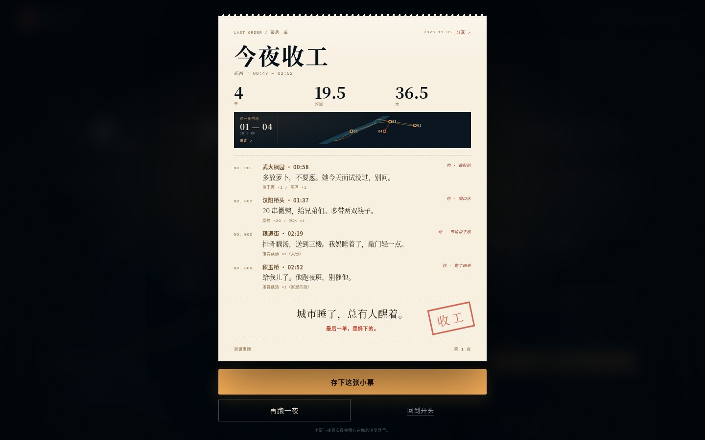

# 《最后一单》设计文档

> 2026 武汉大学「零杯」网页设计大赛 · 壹组
> 主题：市井烟火 · 百味人间
> 形态：单页互动叙事 / 轻游戏

## 1. 概念

- **一句话**：凌晨两点，送完三单外卖，最后一单送到自己家。
- **十秒记忆点**：地图上的订单一个个亮起来，骑手穿过武昌；收工时，四张顾客留言变成一张可以带走的小票。
- **观众路径**：被「最后一单」和夜街首屏抓住 → 进入送单区 → 看订单、接单 → 看地图缩放到路线、电动车穿过武昌 → 到门口二选一 → 收下顾客留言小票 → 三单之后接到「回家」加单 → 收工小票 → 存下 PNG 或再跑一夜。
- **核心命题**：平台会在第二天清空顾客留言。我们把这一晚的几句话留下来，做成一张纸。等待、绕路、多说一句话，都不改变送达，但会改变你记住这座城的方式。

## 2. 为什么从选题开始重做

上一版《等一碗》把镜头放在清晨过早摊的排队上：纸色、宋体、720px 阅读版心、五个人、六种收尾。它完整、克制，但更像一篇可以慢慢读的编辑稿，而不是一件让人想动手的网页作品。用户明确反馈「现在版本不满意，从选题开始完全重构」。

这一版重新做了三件事：

1. **重新选题**：仍然选「市井烟火 · 百味人间」。51 件参赛作品里，这个主题只有 6 件，非遗 35 件、长征 10 件；差异化最高，且允许全部素材原创（不伪造历史照片、不依赖非遗纹样库）。主题不换，换的是题材：从「清晨排队买一碗面」换成「凌晨送四单外卖」。
2. **换视角**：从被服务的食客换成送餐的骑手。骑手是城市夜里最后一批醒着的人，他知道哪条路近、哪扇窗还亮、一碗汤在夜里有多重。这个视角比排队更当代，也更容易把「百味人间」落在具体的人身上。
3. **换形态**：从线性四段阅读换成一张可缩放的地图 + 订单面板 + 门口场景。核心动作从「听两句 / 看表」变成「接单 / 骑行 / 送到 / 留下一句话」。视觉从纸色排印换成夜色、路灯、湿街与纸票的对照。

主题没有更换，因此不触发任务书里「主题最多更换一次」的规则；更换的是题材、视角、信息架构与视觉语言。上一版的代码、场景、文案与截图全部被替换，只在文档里保留这次重做的理由。

## 3. 视觉语言

| 元素 | 规格 | 用途 |
|---|---|---|
| 夜色 | `#04090e` / `#061019` / `#0b1b27` | 页面底、地图、面板 |
| 灯 | `#ffb45c` / `#ff6b45` | 路灯、路线、按钮、强调 |
| 朱红 | `#c8402f` | 印章、招牌、警示、小票章 |
| 纸 | `#ece0c9` / `#e2d2b5` / `#f7efdf` | 小票、留言、收工回执 |
| 青 | `#7fd1c8` | 江面、地图网格、辅助信息 |

- **字体**：宋体标题（Noto Serif CJK SC / Songti SC），黑体正文，等宽字只做时间码、地图标注、编号与金额。标题字号 `clamp(84px, 10.6vw, 164px)`，正文 15–17px / 1.9；不引入外链字体。
- **地图**：一张 1200×760 的夜间示意地图，长江、汉江、长江大桥、黄鹤楼、武大、归元寺、粮道街、积玉桥等为手绘 SVG；道路用低饱和青灰，路线用唯一的高饱和琥珀色。地图不是导航，是叙事舞台。
- **纸**：只有小票是纸。顾客留言、收工回执、场景里的小票都落在纸色上，和夜里的屏幕形成冷暖、软硬、可带走 / 留在屏幕上的对照。
- **场景**：四个门口场景是「电影剧照」式的内联 SVG——一扇亮窗、一把伞、一只外卖袋、桥下的灯、楼道的门、厨房的锅。它们不追求写实，追求一眼能读出「这是哪一刻」。
- **动效**：`cubic-bezier(.22,.8,.24,1)`；地图运镜 720ms、路线按长度 1.4–3.4s、电动车沿路径移动、场景淡入、小票落下、收工印章。`prefers-reduced-motion` 下关闭全部动效与地图雨。
- **不用的东西**：跑马灯、满屏渐变、图库照片、贴纸胶带、预设样式库、外部图标库。

## 4. 信息架构

单页四个锚点 + 两个浮层：

```
#hero 首屏（标题 / 夜街 / 入口 / 路线条）
 └ #ride 送单（地图 + 订单面板 + 骑行进度 + 夜班日志）
    ├ 场景浮层（四段：门口 / 桥下 / 楼道 / 厨房）
    └ 收工浮层（纸票 / 四张留言 / 存 PNG / 再跑一夜）
 └ #notes 今夜小票（四张留言 + 夜班日志）
 └ #about 关于（选题 / 方法 / 素材 / 规格）
```

- 顶部导航编号 01–04，滚动时高亮；`scroll-padding-top` 保证锚点不被吸顶导航盖住。
- 送单区是「地图 + 骑手面板」的双栏：左边是舞台，右边是订单、进度、日志。移动端把面板提到地图之前，先让人接到单，再看到地图。
- 小票区是浅色纸面，和上下的夜色形成一次明确的呼吸；顶部导航在这一段切换为纸色主题。

## 5. 交互设计

### 核心循环

1. **接单**：订单卡显示取餐点、送达点、距离、预计时间、配送费与顾客留言。点「接单 · 出发」进入骑行。
2. **骑行**：地图自动缩放到当前路线（取餐点 + 送达点的包围盒）；路线按实际路径长度绘制，电动车用 `getPointAtLength` 沿路径移动；经过取餐点停一下、弹「取餐完成」，再继续到门口。可以点「跳过骑行」。
3. **门口**：场景浮层给出地点、时间、天气、叙述、顾客的一句话和两个选择。选择不改变订单结果，只改变收尾的一句话；收下这一单的顾客留言小票。
4. **回家加单**：三单送完后，订单面板出现「粮道街 → 积玉桥」的加单，顾客是妈妈。送完打开收工小票。
5. **收工**：纸票统计 4 单 / 19.5 公里 / 36.5 元，列出四张留言；「存下这张小票」用 Canvas 2D 重绘 760×1240 PNG；「再跑一夜」回到第一单。

### 地图

- 相机不是固定镜头：`fitBox()` 取当前路线包围盒，按地图容器的宽高比扩展，最小宽度桌面 540 / 移动 440，留出 96 / 72 的边距；`animateCamera()` 用 ease-out 三次方插值 `viewBox`，720ms。
- 路线分 `approach`（去取餐点）与 `delivery`（送到门口）两段；`runPath()` 按总长度设置 `stroke-dasharray`，逐帧更新 `stroke-dashoffset`，同时把电动车放到路径点上，按前方 8px 的方向旋转车头。
- 已经走过的路线变暗；当前路线是唯一的高饱和琥珀色。取餐 / 送达图钉用琥珀 / 朱红两色，图钉标签只写「取餐 / 送达」，地名留给地图本身。
- 地图上有微弱的雨、江面反光和网格；它们不参与交互，只负责让地图像一张夜里的工作图，而不是一张截图。

### 场景与选择

- 每段场景有一个 `visual` 模板（内联 SVG）和一段 `scene` 数据；打开时替换场景内容，焦点进入第一个选择，`aria-modal` + 焦点陷阱；选择后显示结果、小票和收尾，再「继续送单 / 收工」。
- 顾客留言是每单的收集物；四张小票同时出现在「今夜的小票」区，未送达的格显示「未送达」。完成一夜后，四张全部显影。
- 夜班日志把 00:47 / 00:58 / 01:37 / 02:19 / 02:52 五个时间点串起来；完成一夜后全部点亮。

### 收工小票

- HTML 纸票是页面内的视觉；「存下这张小票」用 Canvas 2D 重绘一张 760×1240、2x 的 PNG（纸纹、统计、四段留言、印章、夜数），不依赖第三方库。中文按字符测量换行，避免长留言溢出。
- `localStorage` 键：`lastorder.v1`；写入 `{ nights, last: { date, tickets, choices, stats } }`。读取时校验数组与字段，旧数据或损坏数据自动降级；`file://` 下写入失败也不影响当前这一夜。
- 「再跑一夜」保留已完成的夜数与上一夜小票，当前这一夜重新开始；刷新后，上一夜仍在「今夜的小票」里。



## 6. 内容与人物

| 单 | 时间 | 取餐 → 送达 | 收件人 | 留言 |
|---|---|---|---|---|
| 01 | 00:47 | 户部巷 → 武大枫园 | 林同学 | 多放萝卜，不要葱。她今天面试没过，别问。 |
| 02 | 01:18 | 粮道街 → 汉阳桥头 | 陈师傅 | 20 串微辣，给兄弟们。多带两双筷子。 |
| 03 | 02:03 | 归元寺 → 粮道街 | 周姐 | 排骨藕汤，送到三楼。我妈睡着了，敲门轻一点。 |
| 04 | 02:41 | 粮道街 → 积玉桥 | 妈妈 | 给我儿子。他跑夜班，别催他。 |

- 前三单是「别人的夜」：考试失利、代驾司机的桥下宵夜、护士下夜班给母亲带的汤；第四单是「自己的夜」。
- 四段场景各两个选择，共 8 个选择；选择只改变收尾的一句话，不改变订单结果，避免「选错就失败」的压力。
- 全部人物、店铺、对话、留言为本队原创虚构；地名取自武汉真实街区；地图为示意，不用于导航。

## 7. 技术方案

- **原生三件套**：`index.html` + `main.css` + `data.js` / `app.js`，无构建、无依赖，`file://` 可直接打开；只有 4 个文本请求。
- **状态机**：`idle → map → riding → scene → scene-result → map → summary`；订单索引 0–2 为三单，3 为回家加单；`state.tickets` 保存四张留言。
- **地图**：SVG `getBBox()` / `getPointAtLength()` / `requestAnimationFrame`；没有地图库、没有 Canvas 地图。
- **存档**：`localStorage`；读取时校验，写入失败静默降级。
- **导出**：Canvas 2D 手绘小票，`toBlob` 下载；无第三方库。
- **性能**：首屏无图片、无外部字体、无第三方脚本；全部图形内联 SVG；站点 4 个文本文件约 152KB，gzip 约 38KB；动效不阻塞首屏；`defer` 加载脚本。
- **兼容**：Chrome 129；使用 `clamp`、`svh`、`text-wrap: balance`、`backdrop-filter`、`getPointAtLength` 等稳定特性；无 ES module，`file://` 可打开。

## 8. 适配策略

| 宽度 | 处理 |
|---|---|
| 1920 | 1240px 容器居中，地图与面板保持双栏，左右留白 |
| 1440 | 基准尺寸；首屏左文右夜街，送单区地图 + 386px 面板 |
| 980 | 送单区改为单列，地图在上、面板在下 |
| 720 | 接单面板提到地图之前；导航去编号；字号与间距收紧 |
| 390 | 场景浮层全屏；收工小票 92vw；地图标签放大；小票单列 |

- 地图相机按容器宽高比重新计算 `viewBox`，移动端最小视野 440，保证路线与图钉不被裁掉。
- 所有尺寸无横向滚动；触控目标 ≥ 44px；不把 hover 当作唯一反馈。
- 顶部导航在经过纸色小票区时切换为纸色主题，回到夜色区再切回，避免深色导航压在纸上。

## 9. 无障碍

- 语义化 `section` + `h1/h2`；跳过导航链接；所有按钮为原生 `<button>`。
- 场景浮层 `role="dialog"` + `aria-modal` + `aria-labelledby` + `aria-describedby`；Tab 焦点限制在当前对话框；Esc 关闭收工小票。
- 地图 SVG 有 `title` 与说明；装饰性 SVG `aria-hidden`；地图图钉不承载唯一信息，订单卡有完整文字。
- 订单卡 `aria-live="polite"`；地图提示 `role="status"`；收工小票打开时锁定背景滚动并聚焦第一个按钮。
- `prefers-reduced-motion` 下关闭地图雨、路线绘制、场景淡入与小票落下；保留内容。
- 正文与夜色的对比度 ≥ 7:1；纸面正文对比度 ≥ 7:1；琥珀按钮配深色文字；朱红只做强调。

## 10. 素材与原创声明

人物、故事、顾客留言、菜单/订单文案均为本队原创虚构；夜街、地图、场景、小票、图标、印章全部为手写内联 SVG 或 CSS；未使用任何竞品截图、图库照片、外部字体、图标库或预设样式库。地图上的真实地名只用于叙事，地图经过压缩与重排，不用于导航；人物无现实原型。

## 11. 评分自评

| 维度 | 自评 | 依据 |
|---|---|---|
| 设计 45 | 42 | 风格 9.5 / 布局 9 / 细节 9 / 素材 8.5 / 导航 5；夜街、地图、纸票三层对照；场景插画仍可更细 |
| 功能 20 | 19 | 四单循环、地图运镜、骑行、8 个选择、四张留言、收工小票、PNG、存档、再跑一夜 |
| 技术 30 | 28 | 零依赖、SVG 地图、路径动画、Canvas 导出、localStorage、CDP 自动回归、响应式 |
| 创意 10 | 9 | 「最后一单是回家」把外卖叙事收回到自己身上；地图 + 纸票的双重叙事 |
| 文档 5 | 5 | README、设计文档、状态、回归脚本与截图同步 |
| 标准分合计 110 | 103 | 设计与内容优先，技术不替代设计 |
| 加分 | +5~10 | 移动端适配 + 本地数据持久化已完成；无后端 |

## 12. 验证与遗留

已在 1920 / 1440 / 720 / 390 四档宽度下检查横向溢出；在 1440 与 390 各跑完一整夜：接单 → 跳过骑行 → 四段场景 → 二选一 → 收工小票 → 存小票 → 再跑一夜。检查项包括：场景层不越界、地图面板完整、四张留言写入 `localStorage`、夜班日志五点、控制台无异常。脚本：`node scripts/regression.mjs`。

尚未完成的验证：真实 Chrome 129 / 真实手机走查；Safari / Firefox 兼容性（比赛指定 Chrome 129，未作为主目标）；音频（本版无音频，安静阅读）。`scripts/pack.sh` 已在空目录实跑：完整版含 progress，匿名版剔除队伍信息与内部文档，两个 zip 解压后均可直接打开 `index.html`。
